# APEXYX Mesh — a self-testing agent economy that runs on a phone

    

`termux` · `android` · `local-ai` · `agentic` · `offline-first` · `self-hosted` · `sqlite`

<p align="center"></p>

Pure Python 3 + bash. No cloud, no daemons you didn't start, no pip installs.
Each tier is one file, one sqlite db in `~/.mesh/`, one installer, and a
hermetic `--selftest` (150–300 checks) that runs in a throwaway tmpdir.

Built and battle-tested on a Google Pixel (Termux). Runs anywhere Python does.

## Install and prove it — one command (Termux or any Linux)

```bash
# Termux only: pkg install python git   (Linux: python3 + git, already there)
git clone https://github.com/xhall-beep/ApexYX-Sovereign.git
cd ApexYX-Sovereign && bash up_all.sh
# installs all ten tiers, then runs every selftest — 421 checks, zero network
# (421 of 421 passing — see "Selftest status" at the end of this README)
```

## Your first 60 seconds on the bus

```bash
mesh post --node me --kind inbox --text "hello mesh"   # feed the router
mesh task --node me --text "echo hi" --for exec        # address a worker
mesh tail                                              # watch the event stream
mesh verify                                            # prove the sealed chain is intact
mesh status                                            # who's alive, what's pending
```

If `mesh` isn't found, open a new shell (the installer adds `~/bin` to PATH).

Or tier by tier:

```bash
cd mesh_bus && bash bus_up.sh       # tier 1 first: gives the mesh shared memory
cd ../mesh_router && bash router_up.sh   # repeat per tier, any order
python3 mesh_router.py --selftest      # prove it before you trust it
```

## Free tiers in this repo

| Tier | Node | What it does |
|---|---|---|
| t1 | bus | shared memory: sealed append-only sqlite bus + `mesh` CLI |
| t2 | router | LLM (or keyword-fallback) request routing onto the bus |
| t3 | exec | command execution node |
| t4 | sched | scheduler |
| t5 | learn | feedback / learning loop |
| t6 | reach | outbound reach |
| t7 | state | shared state |
| t8 | plan | planner |
| t9 | guard | policy guard — refusals are the product |
| t10 | mirror | self-mirroring / audit |

Every node degrades gracefully if the bus is offline — install t1 first anyway;
it's what turns nine scripts into one organism.

## The conductor: sovereign_core.py

The tiers are separate CLIs/daemons that coordinate through the bus.
`sovereign_core.py` (repo root) runs the whole loop as one tick-driven
process — the architecture `docs/termux-tutorial.md` argues for: scheduler
tick → route unrouted inbox items → guard admission (a real lease per
task; denials close the task with a denial result, deferrals stay queued)
→ execute through tier 3's handlers → results back on the bus and into
`results.jsonl` for the tier-4 digest.

```bash
python3 sovereign_core.py --once       # one tick, prints a JSON summary
python3 sovereign_core.py --daemon     # tick forever (--interval S)
python3 sovereign_core.py --selftest   # hermetic proof (9 checks, tmpdir)
```

## Pro: tiers 11–36 (paid)

The full financial-grade stack: federation, sensing, voice, recall, reasoning,
safe-act, negotiation, self-repair, forecasting, budgeting, markets, coalitions,
staking, insurance, reinsurance, solvency, liquidity, clearing/CCP, recovery,
macroprudential control, supervision, accountability, a fiscal backstop, a polity tier —
mandates, legislature votes, vetoes, sunset clocks and a debt brake deciding
who may aim that backstop — and now a **constitutional layer**:
sealed commitments, escalation ladders, clawbacks, taxpayer-loss accounting.
**5,000+ hermetic self-test checks across the stack.**

→ Buy it: https://stephenhall8.gumroad.com/l/apexyxpro ($49 CAD, instant download)

**NEW — t37 treaties just shipped:** the mesh now has a foreign policy that
cannot outrank its constitution. A citizen proposes a compact against a named
foreign mesh; ratification takes a majority of the WHOLE t35 franchise (one
node one vote) AND the counterparty's countersign — a hash bound to the exact
sealed treaty text, so text tampering or seal-swapping voids accession. The
entrenched core (art.seals, art.sunset, art.onevote) is non-derogable: a
compact touching it cannot even be proposed. Entry into force grants mutual
recognition and comity — foreign parties gain standing to file breach claims
via a pubseal-derived token. Breach arbitration is adversarial (claim AND
reply sealed before a deterministic 3-node tribunal): majority finds the
breach founded, awards are enforceable on a 14-day clock — reparations,
suspension-that-marks, or a denunciation referral (arbitrators cannot kill a
treaty; termination goes back to the franchise). Exit is lawful but never
silent: a sealed 14-day notice window, or sunset after the term. Treaties per
counterparty and awards per treaty hash-chain into tamper-evident lineages.
69 hermetic selftest checks. t36 judiciary (52) and t35 constitution (43)
shipped previously. Pro buyers get every new tier as it ships — re-open your
download link for the updated bundle.

Next tier in development: **t38 succession-of-state** — what happens to
treaties, case law, and the franchise when a mesh forks, merges, or migrates
hardware.

Full story + free download mirror: https://slackstack-1a8ac6.viktor.page/apexyx-mesh

## Design rules the whole mesh obeys

- Every db write is evented; nodes never re-ingest their own events.
- Sibling dbs are opened read-only. Sealed rows break their hash if mutated.
- Supervisory states never self-clear — lifting a freeze is an explicit act.
- Selftests are hermetic: tmpdir MESH_DIR, simulated siblings, zero network.

MIT licensed. Issues and PRs welcome.

## Deep dive

- [Running a 10-tier SQLite Agent Mesh on Termux without Thermal Throttling](docs/termux-tutorial.md) — the engineering: tick-driven architecture vs daemons, WAL as the bus, thermal admission control, phantom-process-killer survival.

## Discussion

- Hacker News: https://news.ycombinator.com/item?id=49398962

## Related

- **APEXYX Mesh Console** — Android APK (Kivy) running a sealed-chain task bus
  in your pocket: https://github.com/xhall-beep/APEXYX_ORI_AI

## Selftest status (verified 2026-10-29)

All ten tiers' hermetic selftests were run end-to-end in-tree
(the CI commands, on the estate VM). Honest totals: **421 of 421
checks pass.** Per tier:

| Tier | Result |
|---|---|
| mesh_bus | 125/125 |
| mesh_exec | 6/6 |
| mesh_guard | 49/49 |
| mesh_learn | 23/23 |
| mesh_mirror | 94/94 |
| mesh_plan | 32/32 |
| mesh_reach | 30/30 |
| mesh_router | 5/5 (keyword engine; model engine untested offline) |
| mesh_sched | 19/19 |
| mesh_state | 38/38 |
| sovereign_core | 9/9 (new; the conductor's own checks, outside the 421) |

The mesh_guard lease/budget failures recorded on 2026-10-28
(39/49) were root-caused and fixed in the guard code — no test was
touched. The guard's storage sensor measured free space on whatever
volume held MESH_DIR; in the hermetic selftest that is a tmpdir, and
on a small tmpfs (this VM's /tmp is 512 MB) it read scratch-RAM
headroom as a nearly-full disk, so `decide()` denied every
model/shell admission and the lease/budget/wrap checks cascaded.
The sensor now recognises tmpfs/ramfs mounts and measures the home
volume instead — the persistent storage the floor exists to protect.
The suite passes both normally and with /tmp deliberately filled to
the recorded failure condition (358 MB free).
